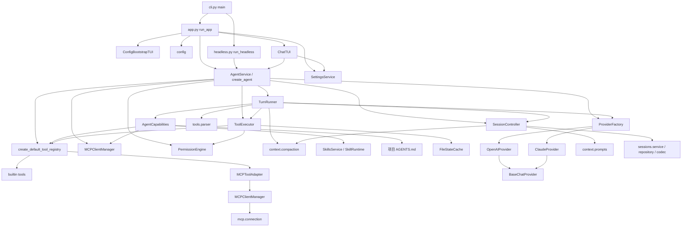
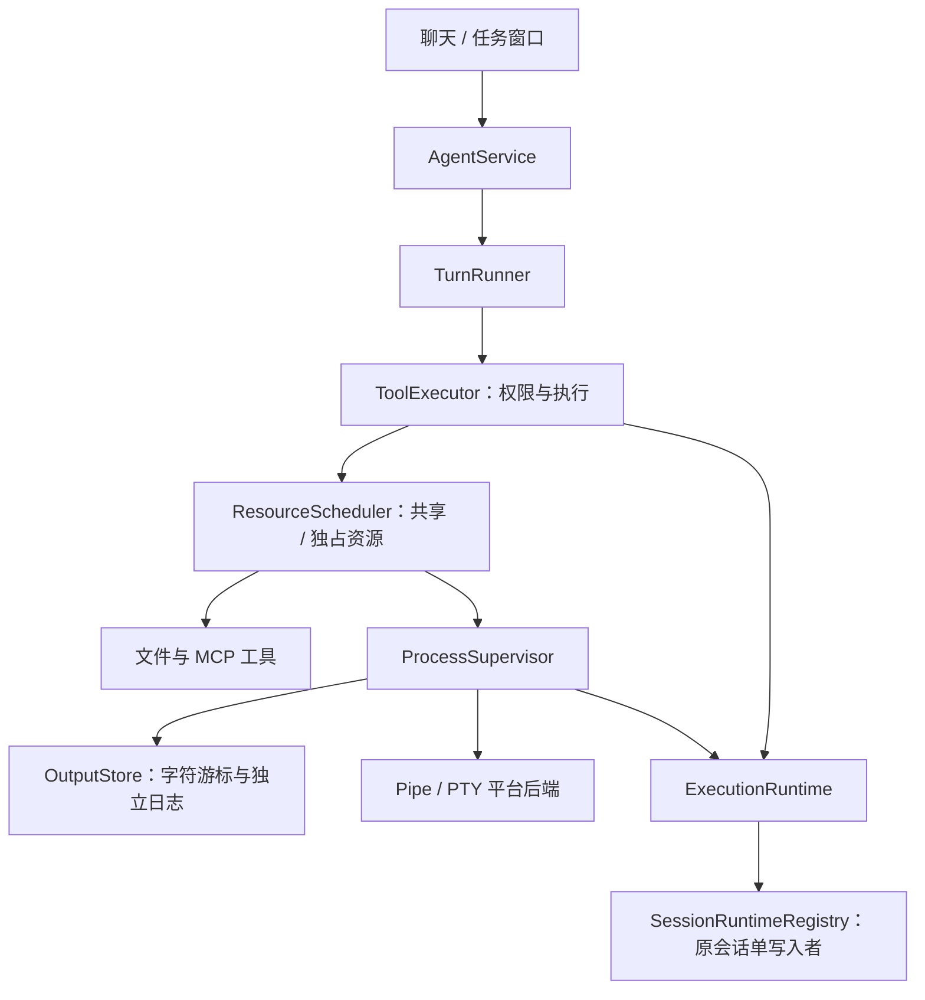

# 架构

## 整体架构

LanCher Code 的核心是**单进程、异步（asyncio）**的编程 Agent，通过公共 SDK 供 TUI、无界面 CLI 和嵌入应用调用：

```text
用户
 ↓ 键盘输入
┌─────────────────────────────┐
│ Textual TUI（tui/）          │  界面层：渲染、键盘、弹窗
└─────────────────────────────┘
 ↓ 公共操作 / 事件快照
AgentService（lancher_code.sdk）
 ↓ 统一装配、能力就绪、队列与生命周期
┌─────────────────────────────┐
│ TurnRunner（agent/runner.py） │  流程层：ReAct 工具循环
└─────────────────────────────┘
     ↓             ↓              ↓
┌──────────┐ ┌───────────┐ ┌──────────────────┐
│ Session  │ │ Provider  │ │ ToolExecutor     │
│Controller│ │ (openai/  │ │  + ToolRegistry  │
│ (会话层) │ │  claude)  │ │  + Permission    │
└──────────┘ └───────────┘ └──────────────────┘
     ↓             ↓              ↓
 提示词构建     模型 API      文件系统 / shell / MCP Server
```

关键设计决策：

- **协议无关的 transcript**：会话层保存的是 `ConversationMessage` 抽象消息，由 Provider 在发送前各自序列化为 OpenAI / Claude 协议格式（见 `providers/*` 的 `_serialize_message`）。
- **公共 SDK 边界**：前端只调用 `AgentService`，不持有 Runner 或 SessionController。`AgentConfig` 不含 UI，核心导入不加载 Textual / Rich。
- **事件流解耦**：内部 Runner 产出 `TurnEvent`，服务发布深拷贝快照与递增序号。服务成功结束后自动推进 follow_up 队列；`run()` 收集 `AgentResult`，默认拒绝无人处理的审批。
- **能力管理在核心**：`AgentCapabilities` 装配技能工具，管理 Skills 激活、项目约定投影与 MCP 生命周期。TUI 只展示核心快照和调用公共管理接口；其他前端复用同一门面。
- **阶段与权限独立**：讨论、计划、执行决定可用工具范围，`project` / `full` 决定执行访问。阶段边界同时应用于工具发现和实际执行。
- **权限判定在工具执行前**：`ToolExecutor` 对每个工具调用先过 `PermissionEngine`，只有 `allow` 才真正执行。
- **全程异步**：`app.py` 在 `asyncio.run()` 中运行；网络请求（httpx）、子进程（run_command 工具）、文件卸载（`asyncio.to_thread`）都是异步的。

## 核心组件

| 组件 | 类 / 入口 | 职责边界 |
|---|---|---|
| 公共 SDK | `sdk.py`、`AgentService`、`create_agent` | 显式配置与依赖装配、能力就绪、快照、队列、结果与完整收尾 |
| 宿主适配 | `app.run_app()`、`headless.run_headless()` | TUI 引导与设置、无界面参数和输出，共同消费 SDK |
| 会话控制器 | `SessionController`（`sessions/controller.py`）与 `sessions/` | 会话状态、transcript、阶段、权限、计划与队列；独立 UUID 和事件日志持久化 |
| 工具循环 | `TurnRunner`（`agent/runner.py`） | 回合调度、忙时输入投递、取消、压缩与计划确认 |
| 智能体能力 | `AgentCapabilities`（`agent/capabilities.py`）、`SkillRuntime` | Skills 发现与激活、系统上下文、项目 AGENTS.md、MCP 后台初始化与管理 |
| 上下文治理 | `context/`（tokens、budget、request、offload、compaction、summary、recovery） | 可靠输入校准、动态额度、结果卸载及摘要候选验证 |
| 请求用量 | `usage/ledger.py`、`tui/usage.py` | 按请求事实保存消耗，生成会话/本次启动统计并一致显示未知与部分字段 |
| 权限引擎 | `PermissionEngine`（`permissions/engine.py`）/ `PermissionStorage`（`permissions/storage.py`） | 权限判定与规则存储，不执行工具 |
| 工具系统 | `ToolRegistry` / `ToolExecutor` / `Tool`（`tools/`） | 工具注册、调度、执行 |
| 模型供应商 | `ChatProvider` 协议 + `BaseChatProvider`（`providers/`） | 统一流式事件输出 |
| MCP 客户端 | `MCPClientManager`（`mcp/`） | MCP Server 生命周期与工具注册 |
| 设置服务 | `SettingsService`（`config/settings.py`） | 模型、界面偏好、MCP、权限规则的隔离保存与校验 |
| TUI | `LanCherTextualApp` / `ChatTUI`（`tui/app.py`） | 界面渲染与交互 |

领域类型由各自的 `models.py` 维护，跨领域消息、工具和控制契约位于 `contracts/`。`providers/catalog.py` 接收供应商映射与显式模型引用，不依赖 `AppConfig`；`config/loader.py` 可以复用目录解析而不形成循环。`agent/` 拆分输入、模型选择、流收集和工具批次；`sessions/` 分开事件存储、状态编解码与控制；`context/` 集中预算、提示词、请求组装、卸载与摘要。

## 模块依赖关系



## 核心数据流：一轮对话

以下为一次用户输入从进入到结束的完整路径（详细流程见 [workflows/user-turn.md](workflows/user-turn.md)）：

```text
用户输入
→ ComposerTextArea 提交（tui/composer.py 发出 ComposerSubmitted）
→ LanCherTextualApp.handle_input_submitted
   ├─ 工作中：按用户选择保留草稿、补充当前任务或排到下一轮
   ├─ 解析斜杠命令（tui/commands.py），命中则先执行命令
   └─ AgentService.run_user_turn(text) → 内部 TurnRunner.run_user_turn(text)
       ├─ SessionController.create_user_message()  创建用户消息 + 动态提醒
       ├─ SessionController.create_assistant_message()
       └─ 工具循环（最多 tool_loop_limit 次）：
           ├─ 估算 Token，必要时自动压缩上下文
           ├─ SessionController.build_request() → 组装 ChatRequest
           ├─ Provider.stream_chat(request) → StreamEvent 流
           │    ├─ text_delta → 追加到消息内容
           │    ├─ thinking_delta → 写入思考轨迹
           │    └─ tool_call_delta → ToolCallAssembler 拼接
           ├─ ToolCallAssembler.finalize_batch() → 完整工具批次或原编号错误反馈
           ├─ ToolExecutor.execute_calls()：
           │    ├─ 冻结参数 + 标准 JSON Schema 校验（离线引用解析）
           │    ├─ 阶段工具边界 + PermissionEngine.evaluate()（五层判定）
           │    ├─ 需要确认 → PermissionRequest → TUI InlinePermissionPanel → 用户选择
           │    └─ 执行工具（权限复核 + 资源调度 + 托管执行）
           ├─ 工具结果写回 transcript，事件回传 TUI
           └─ 循环直到模型不再调用工具
→ SessionController.complete_message()  标记完成 + 累计用量
→ 事件流结束，TUI 更新状态、自动保存会话；成功后可投递下一条排队输入，取消/失败则暂停队列
```

## 阶段边界与权限系统

`tool_available_in_phase()` 限定阶段工具资格，权限引擎进一步检查实际操作。讨论和计划有效只读，只有计划专用工具可以写计划；Shell 仅在完整分析为只读时允许。执行阶段保存 `execution_access=project|full`：项目内操作自动，外部访问在 project 下审批，full 下自动。极危险操作与显式拒绝先于自动允许。

外部审批只绑定本次调用或当前会话明确的目录范围；执行前复核目标、版本和取消状态，成功后保存会话目录授权。永久规则仅 deny。权限是检测式应用层判断，不能保证识别任意脚本动态外部访问，未增加操作系统沙箱。详见 [权限模块](modules/permission-engine.md)。

## 关键对象生命周期

### `SessionController`（`sessions/controller.py`）

```text
create_agent() 装配，由 AgentService 持有
→ 绑定 provider_config / cwd / 初始阶段与权限，尚无 Session ID
→ 每轮对话：create_user_message → create_assistant_message → 流式追加 → complete_message
→ 首条用户消息：先创建 UUID Session 和 workspace，再调用模型
→ 状态变更：增量追加事件，流式短间隔刷新、关键边界同步刷新
→ /session new 或 resume：刷新旧会话并切换写入者
→ 有后台或控制操作的原会话保留写入者；闲置后保存快照并释放
→ 应用退出：先收尾托管进程，再 close 刷新、写快照、释放文件锁
```

### `TurnRunner`（`agent/runner.py`）

```text
构造时注入 provider / session / registry / executor
→ run_user_turn()：创建后台任务 _run_turn + 事件队列
→ AgentService 发布快照，TUI / 无界面 CLI / SDK 调用者逐个 await 事件
→ 事件流结束（_QUEUE_END）后任务回收
→ 工作中输入：steer 在安全边界投递；follow_up 等当前任务成功结束后排到下一轮
→ cancel_active_turn()：取消令牌 + 取消任务 + 取消挂起的权限请求 + 暂停待处理输入
```

### MCP 连接（`mcp/connection.py`）

```text
MCPClientManager.initialize() → 每个 Server 并行 connect_and_list_tools()
→ MCPServerConnection 后台任务运行（stdio / streamable_http）
→ 初始化 + 分页列出工具 → 按 Server 注册延迟工具
→ 支持目录变更通知与手动 refresh / reconnect / reload
→ 退出时 AgentCapabilities.shutdown() 统一关闭
```

## 设置与首次配置

首次配置按“连接供应商 → 添加第一个模型 → 确认并开始”进行，仅最终确认写入配置。供应商保存连接地址、密钥、协议与超时，模型保存 API 名称、显示名称和可选覆盖；模型通过稳定引用 `provider_id/model_id` 标识。

设置默认打开供应商与模型目录，分别显示“本次对话使用”和“新对话默认”。切换本次模型只更新运行时；更改默认只影响新对话。每个表单独立保存，成功后返回目录，返回时只丢弃当前未提交草稿，此前提交保留。

`SettingsService.save_models/save_ui/save_mcp/save_rules` 隔离保存域；模型和偏好通过回调更新运行时，权限规则立即热更新，MCP 保存后调用能力核心重读配置并更新连接与工具。写盘成功与运行时更新失败分别报告，MCP 可用 `/mcp reload` 重试。旧单模型配置明确拒绝并提示重新配置，原文件保留，不迁移或生成备份。

## Skills 与项目上下文

`SkillsService` 只发现项目与用户 `.lancher/skills`，元数据、正文快照与引用资源分开。用户 `$技能名` 在输入生效时由核心激活；模型依据目录描述调用 `load_skill`，正文通过回调保存在会话上下文状态，并投影为尾部主机事件，工具历史仅保留确认。

技能正文跨轮保留；成功压缩把正文回收、保留引用与指纹，后续需要时先重载。压缩候选状态与原状态分开，失败或取消不卸载正在使用的技能。会话禁用与主动卸载同样由核心管理并持久化。

项目根 `AGENTS.md` 常驻提供，初始规则进入固定前缀，更新通过尾部事件追加。成功压缩后新前缀继续包含项目约定。技能和项目约定都不提升执行权限。系统设置中的原生 MCP 工具追加默认关闭，只有支持端点适用；常规模式保持 `tools` 数组。详细格式和使用例见 [Skills 与项目约定](modules/skills.md)、[请求前缀](modules/prompting.md)。

## 并发与异步模型

- 单 asyncio 事件循环，无多线程业务逻辑；文件 IO 通过 `asyncio.to_thread` 卸载（如大工具结果落盘）。
- `ToolExecutor` 按可信资源声明调度共享/独占访问，无冲突操作并行，冲突操作按顺序执行。调用期间资源在工具返回时释放，持续资源由后台进程保留，但不占普通调用并发额度。
- MCP Server 初始化并发进行，单个失败不影响其他 Server。
- 权限弹窗期间，`TurnRunner` 通过 `asyncio.Future` 挂起等待用户决议，不阻塞事件循环。


## 托管执行与 Session Runtime



一次工具调用结束与进程退出分别建模。调用返回 running 后，进程保留UUID、所属Session以及明确声明的持续资源；未知Shell的项目独占仅本次调用期间，因此返回后台任务后可继续请求服务或编辑源码，不证明后台没有真实文件副作用。profile资源默认保留到进程退出，也可明确仅保留到调用结束；未声明MCP仍在本次调用期间项目独占。停止本轮只回收turn进程，Session后台继续。TUI只是观察者，关闭任务窗口不停止进程，应用退出先收尾所有托管资源再关闭写入者。

执行状态先提交原Session投影，再通过执行器回调更新Runner的对话轨迹和TUI。待批准、资源排队和实际运行分别展示；资源队列携带真实阻塞任务身份与资源，开始或结束后清除旧等待快照。

后台事件先落到原Session日志与收件箱，下一条用户消息时纳入协议上下文；完成不会自动开新轮次。Session切换保留有活动资源的运行绑定，重启则标记旧活动记录lost，不认领PID、不重跑命令。

细节与实际场景见 [工具执行](workflows/tool-execution.md)，包括停止竞态、Windows Job Object、ConPTY输出关闭与UTF-8分页。
