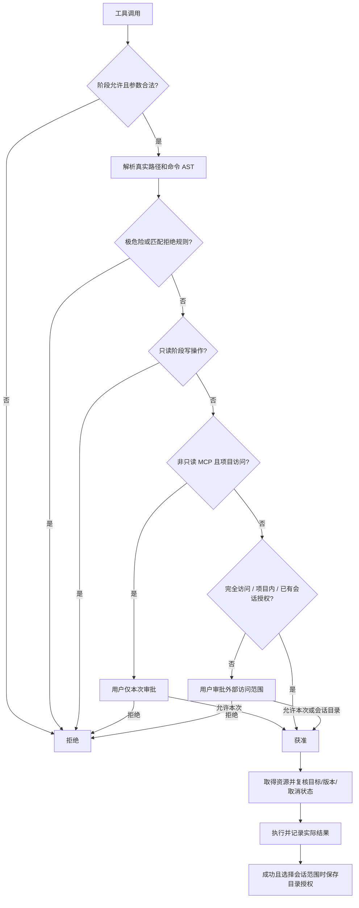

# 权限与访问范围

权限分为三个有效模式：`read_only`（只读）、`project`（项目访问）、`full`（完全访问）。`runtime.execution_access` 只保存执行阶段选择 `project` 或 `full`；讨论和计划阶段强制只读，回到执行阶段恢复原选择。

| 操作 | 只读 | 项目访问 | 完全访问 |
|---|---|---|---|
| 项目内读取和搜索 | 自动允许 | 自动允许 | 自动允许 |
| 项目外读取和搜索 | 审批 | 审批 | 自动允许 |
| 普通写入和删除 | 拒绝 | 项目内自动，项目外审批 | 自动允许 |
| 计划文件 | 仅计划阶段的专用 write_plan_file | 由工具阶段限制 | 由工具阶段限制 |
| 明确只读的 Shell | 按读取范围检查 | 项目内自动，识别到外部访问则审批 | 自动允许 |
| 其他 Shell、脚本、进程输入 | 拒绝 | 项目内自动，识别到外部访问则审批 | 自动允许 |
| 声明只读的 MCP | 自动允许 | 自动允许 | 自动允许 |
| 其他 MCP | 拒绝 | 本次审批 | 自动允许 |
| 已识别的极危险操作 / 显式拒绝规则 | 拒绝 | 拒绝 | 拒绝 |

## 决策和执行

`PermissionEngine.evaluate(call, tool, context)` 先检查阶段，再解析真实路径、Shell AST 和风险；极危险操作与拒绝规则优先，随后判断当前访问范围及会话目录授权。`ToolContext` 带有 `work_phase`、`execution_access`、`project_root`、`cwd`、会话目录和冻结审批目标。



审批可选择 `allow_once`（精确绑定本次调用）、`allow_session`（请求明确列出的真实绝对目录范围）或 `deny`。目录范围显示读或读写、是否包含子目录；写授权包含读，但进入只读阶段仍不能写。远端 MCP 等没有目录范围的请求仅提供本次批准。授权保存在会话状态中，新会话清空，不写项目或用户配置。未来的模型自动审批本次没有实现。

调用参数冻结后，执行器在审批后、资源等待后及开始执行前重新检查。删除清单逐项验证；目标变更、取消、失败均不保存新授权。已经产生的部分效果会记录，不自动重试。

## 路径、删除和 Shell

项目范围用规范化绝对路径和解析后的链接目标判断，避免字符串前缀误判。外部路径经批准或处于完全访问模式时，专用文件工具、查询与 Shell cwd 才能实际访问。硬链接、控制文件和变化中的目标仍受文件一致性守卫保护。

项目内单文件及目录删除自动执行；目录必须显式 `recursive: true`。项目外删除按访问模式审批。项目根、磁盘根、系统关键目录、用户主目录和会话控制记录不能整体删除。`.git`、Git reset --hard / clean -fd、普通递归删除不再因名称永久拒绝。删除使用最多 10000 项的完整清单，链接只删除本体，不遍历其目标；超限不静默截断。取消或部分失败返回已删除项和 `automatic_retry=false`。

PowerShell 使用与执行一致的固定解析器，用户命令通过 stdin 传入解析辅助脚本；Bash/sh 使用 tree-sitter-bash。分析识别读、写、删除、cwd 与程序位置；可确定的外部数据访问参与审批，项目外安装的解释器位置不会单独触发审批。格式化、擦除磁盘、删除分区以及可确定的整体危险删除被拒绝。引号中的文字不是实际命令。

无法完整分析的 Python、Node、npm、变量、循环、嵌套解释器以及超预算命令，在项目访问/完全访问模式下不因未知本身要求批准；已识别的外部范围和极危险操作仍生效。只读模式仅允许已经确认只读的 Shell。

这是应用层检测式权限，未增加操作系统沙箱。项目内脚本动态访问外部目录可能无法提前识别；所有实际执行的进程均使用本机账号权限。MCP 的只读声明由服务器提供，目录边界不能约束远端行为。

## 额外拒绝规则

`PermissionStorage` 读取会话、项目和用户的额外拒绝规则。所有规则仅接受 `deny`，精确或 glob 匹配；可选 `command_cwd` / `command_shell` 必须成对填写。命令规则同时检查整体命令与各子命令。设置页没有永久允许选项。

项目：`./.lancher/permissions.yaml`；用户：`~/.lancher/permissions.yaml`。

```yaml
format_version: 2
rules:
  - match: RunCommand(danger-tool *)
    result: deny
    match_kind: glob
```

旧 `permission_policy` / `permission_mode`、旧执行策略值、旧权限文件和版本 2 会话均明确拒绝，报告文件位置并保留原文件，不迁移、映射或覆盖。当前会话事件版本为 3；上下文子格式仍为 2。
