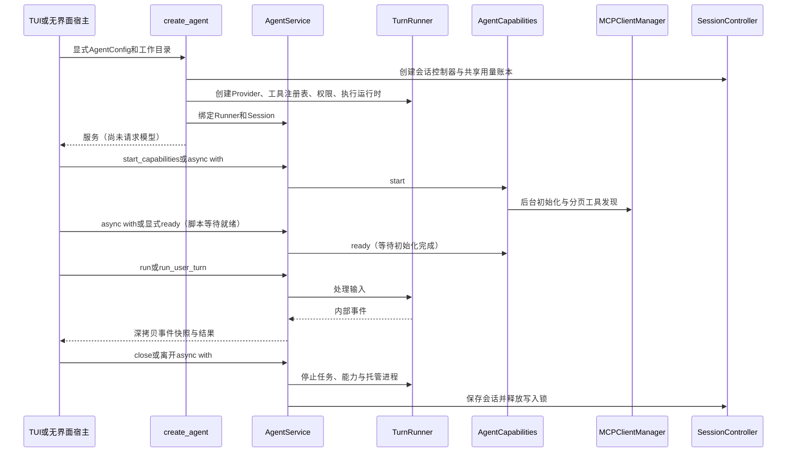

# 流程：程序启动

入口统一经过 `cli.main()`。无参数进入 TUI，`run` 子命令进入无界面适配器；两者使用公共 Agent SDK。帮助和参数校验在导入宿主之前完成。

## 核心装配与生命周期

装配位于 `agent/factory.py`，生命周期位于 `agent/service.py`。模型切换后的 Provider 继续观察同一账本；恢复会话不把历史消耗导入本次启动账本。首条用户消息才创建 UUID Session 和独立 workspace。

## TUI 宿主

无参数 `lancher` 只在选定 TUI 分支后导入 `app.py` 和 Textual/Rich。缺少界面依赖时提示安装 `tui` extra，返回 `1`。

1. 初始化日志，检测 `~/.lancher/lancher.yaml`。
2. 文件不存在时运行三步配置引导，用户取消返回 `0`。
3. 校验主配置并用 `AppConfig.to_agent_config()` 创建 SDK 服务。
4. 创建界面设置服务和 `ChatTUI(agent=...)`，核心后台初始化 MCP，界面展示进度。
5. 界面消费快照与调用公共操作；初始化期间即可使用已注册的内置工具，MCP 目录在后台更新。
6. 退出时由 AgentService 统一收尾，宿主回到普通终端后打印恢复信息和本次用量；清理失败返回 `1`。

首次引导写入主配置和 MCP 模板；SDK 不启动引导。配置详情见 [配置说明](../configuration.md)，TUI 退出交互见 [结束工作与恢复](app-exit.md)。

## 无界面宿主

`lancher run "任务" --config PATH` 进入 `headless.run_headless()`，不导入 TUI：

1. 获取任务参数或标准输入，拒绝空任务。
2. 读取显式模型配置，转换为 AgentConfig，注册日志敏感值。
3. 创建服务并进入 `async with`，等待能力准备。
4. 可选恢复会话；显式 `--model` 优先于保存模型。
5. 运行并消费结果，JSONL 时逐条发布事件、对审批明确拒绝。
6. 成功、失败、取消、超时均先关闭服务，再按格式输出最终结果。

命令保留配置中的阶段与访问范围，默认拒绝需要批准的请求。总超时包含初始化与任务处理；触及后等待收尾，因此退出可能晚于指定秒数。`text` 回答写 stdout，错误写 stderr；`json` / `jsonl` 的 stdout 保持机器可读。

| 退出码 | 场景 |
|---|---|
| `0` | 任务完成或 TUI 正常退出 |
| `1` | 配置、任务或关闭失败 |
| `2` | 参数解析失败 |
| `124` | 无界面任务总超时 |
| `130` | 取消或中断 |

参数、结果契约和 Python 嵌入示例见 [Agent SDK 与无界面运行](../agent-sdk.md)。
